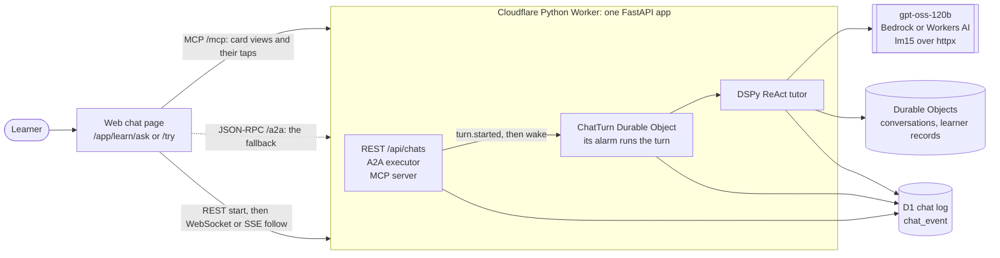
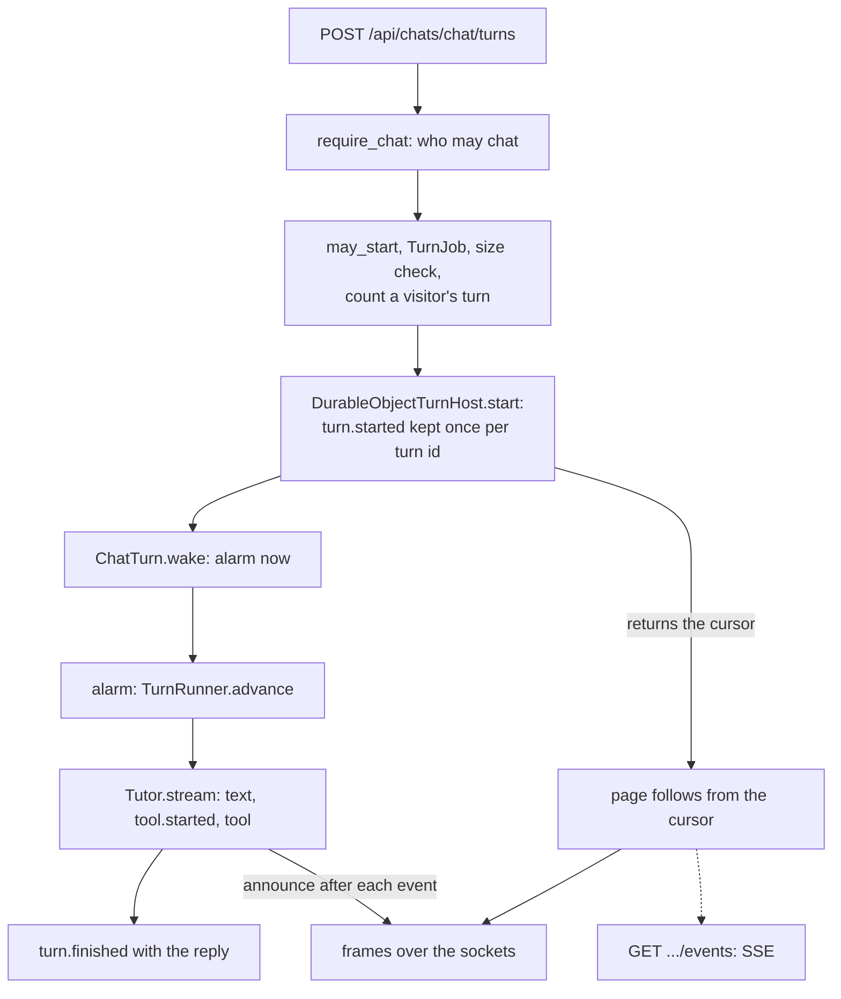

# The tutor chat

How one chat turn runs, from the learner's tap to the words on screen, and what keeps it from being lost. It reads the code on `main`. Where a fact lives only in a deployment (a dashboard value, a secret, live behaviour) it says so. The deeper pages are linked, not repeated: [Durable turns](DURABLE_TURN.md), [What a cut connection loses](CHAT_TURN_LOSS.md), [API](API.md), [Security](SECURITY.md), [Tool results](TOOL_RESULTS.md), [Tutor guards](TUTOR_GUARDS.md), [Answer gate](ANSWER_GATE.md), [MCP Apps compliance](MCP_APPS_COMPLIANCE.md), [State machines](STATE_MACHINES.md) and [Specs](specs/README.md).

Paths are from the repository root. `server/` stands for `apps/server/src/app/` and `web/` for `apps/web/src/`.

## 1. Overview

One turn is one message from the learner and the tutor's answer. The tutor is a DSPy ReAct agent: at each step it calls a tool or answers. The model is gpt-oss-120b on Bedrock (`LLM_HOST=bedrock`, the default) or on Workers AI (`workers-ai`), called through DSPy's own engine, lm15, over an httpx transport. There is no LiteLLM (`server/llm/client.py`, `server/llm/hosts.py`; [Architecture](ARCHITECTURE.md#workers-runtime-rules)). R2 holds voice recordings and the teacher's audio, and the text chat never touches it.

### Two ways to run a turn

| | Durable turn (REST) | A2A fallback |
|---|---|---|
| Start | `POST /api/chats/{chat}/turns` | `message/stream` JSON-RPC at `/a2a` |
| Who runs the tutor | The chat's `ChatTurn` Durable Object, in an alarm | The request that carries the stream |
| Follow | WebSocket, or server-sent events, from a cursor | The same A2A stream |
| A dropped connection | The turn is in the log; the page follows again | The SDK keeps consuming after the client leaves, but a retry is a new turn |
| The isolate dies | The watchdog alarm resumes the turn | The turn is lost |
| Needs | `DURABLE_TURNS=on`, `CHAT_LOG=on`, the `CHAT_TURNS` binding | Nothing |

**Which one the web uses.** `askTurn` (`web/lib/chat-turn/ask.ts`) takes the REST path while `server.keepsTurns` is true. A server that keeps no turns answers `404` with code `turns_unavailable` (`app.state.turns is None`, `server/api/chat_routes.py`). The page then catches `TurnsUnavailable`, sets `keepsTurns` to false for the life of the page and asks over A2A with `askAgent` (`web/lib/a2a/client.ts`). So the path follows the server's configuration, not a build flag. By the committed `apps/server/wrangler.jsonc`, staging runs durable turns and production does not (section 6). I could not check what is deployed.

**Why.** [CHAT_TURN_LOSS.md](CHAT_TURN_LOSS.md) measured that a dropped stream does not stop the turn, so the web's retry (a new message id in the same conversation) saved the exchange twice in 10 of 10 runs. It also found, from the code and the [TLA+ spec](specs/README.md) and not by measurement, that a turn cut off before the model finishes leaves nothing, because the exchange is appended when the model ends. The durable path writes the turn before work starts, resumes it from the log and keeps the exchange once per turn id.

## 2. Frontend

### Routes

| Route | What it is |
|---|---|
| `/chat`, `/app/chat` | Redirect to `/app/learn/ask` (`web/app/chat-link.ts`) |
| `/app/learn/ask` | The chat hub (`web/app/learn/ask-page`) |
| `/app/learn/ask/general`, `/ask/subject/:subjectSlug`, `/ask/:subject/:topicIndex` | One chat each, for a general, subject or topic scope (`web/features/learn/lib/chat-targets.ts`, page `web/app/learn/chat-page`) |
| `/try` | The public chat (`web/app/try-link.ts`, `web/app/try-page.tsx`) |

The routes under `/app/learn/ask` sit behind `requireAccount` (`web/app/chat-gate.ts`). With no account the page goes to sign-in; with an account and no learner chosen it goes to choose one. The chat asked for is remembered and opened afterwards.

**How `/try` differs.**

- No sign-in. A signed-in learner who opens `/try` is sent to their own chat; an account with no learner chosen is asked to choose one.
- The page holds an anonymous session (`holdAnonymousSession`), so every request carries a session that names a random **visitor id** and no device or learner (`web/lib/api/session.ts`, `web/lib/try-visitor.ts`).
- Text only. The page is a header with the logo and a sign-in link around the same `ChatView`. It has no navigation, and the chat components have no voice input.
- The device makes its own plan with no subjects and no country (`readyToChat`, `web/features/learn/lib/start-chat.ts`). What the visitor says about themselves stays in the browser, and a country the device guessed is never kept as theirs: the form confirms it.
- The server counts the visitor's turns and answers `429 try_limit` past its limits (section 6). No thread sync runs for a visitor, so conversations stay on the device.

### Modules

| Module | Job |
|---|---|
| `web/lib/chat-turn/ask.ts` | `askTurn`: start a turn, follow it, return the reply. Picks REST or A2A. Handles the learner's stop |
| `web/lib/chat-turn/rest.ts` | `startTurn` (retried up to three times, at 300, 900 and 2700 ms, with the same turn id), `stopTurn`, `TurnsUnavailable` |
| `web/lib/chat-turn/follow.ts` | `followTurn`: reads a turn to its end across connections that drop. A socket first, server-sent events after two failed opens. Back-off from 250 ms to 5 s with jitter. Shows "reconnecting" after 1.2 s down. Gives up 11 minutes after it began |
| `web/lib/chat-turn/links.ts` | `socketLink` and `eventsLink`: one connection each, from a cursor. A socket pings every 15 s and counts 40 s of silence as dead; events count 30 s of silence as dead |
| `web/lib/chat-turn/frames.ts` | `parseFrame`, and `Cursor`, which applies each frame once: it skips a seq at or below the cursor and reports a gap when `prev` is not the cursor |
| `web/lib/chat-turn/queue.ts` | Turns socket callbacks into an async generator |
| `web/lib/a2a/client.ts` | The A2A fallback (`askAgent`) on `@a2a-js/sdk`. Renews an expired token on `401`. One silent retry after a retryable failure if no words had arrived. Also the `LearnerContext` type |
| `web/lib/a2a/request-data.ts` | Builds the message parts: the text, and a data part with `appCalls` and `unanswered` |
| `web/lib/a2a/reply-data.ts` | Reads the reply's data part field by field: `followUps`, `actions`, `cards`. A malformed part costs the extras, not the answer. Also the tool names the activity line knows |
| `web/lib/a2a/rpc-errors.ts` | Turns JSON-RPC and A2A error codes into the HTTP status that says whether a retry could pass |
| `web/features/learn/lib/tutor-turn.ts` | `runTurn`: the turn from the page's side. Stores the question, streams the words into a message, stores the reply with its follow-ups and card, carries out the actions, words a failure |
| `web/features/learn/hooks/use-tutor-turn.ts` | One turn in flight at a time. Holds the stop controller, the activity line and the reconnecting flag |
| `web/features/learn/hooks/use-tutor-chat.ts` | Wires the message store, threads, plan changes, the turn and the thread sync |
| `web/features/learn/hooks/use-tutor-actions.ts` | Carries out the reply's `actions` on the learner's plan. A change that clears progress waits for the learner |
| `web/features/learn/lib/tutor-context.ts` | What the page tells the tutor each turn (below) |
| `web/features/learn/hooks/use-app-host.ts` | The host side of a card: keeps the view's tool calls and sends them with the next message |
| `web/features/learn/ui-apps/view-bridge.ts`, `app-frame.tsx` | `AppBridge` (MCP Apps) and the iframe that shows a card |
| `web/lib/mcp/` | The `/mcp` client for the views, the sandbox address, and an outbox for calls made offline |
| `web/lib/threads/` | Thread sync with `/api/learner/threads` |
| `web/lib/chat-db.ts`, `web/lib/idb.ts` | IndexedDB (`graspy-db`), stores `chat-history` and `chat-threads` |

### What a turn sends

`startTurn` posts `{turn, parts, metadata}`. `turn` is a fresh random id for each question. The chat id is the thread's `agentContextId`, or a new random id for a thread's first turn. `parts` are `{text}` and, when there is anything, `{data: {appCalls, unanswered}}`. `appCalls` are the taps the learner made on cards since the last message. `unanswered` are the learner's earlier messages whose turns failed.

`metadata.learner` is the `LearnerContext` that `scopeContext` (`tutor-context.ts`) makes from the saved plan:

| Field | Meaning |
|---|---|
| `country`, `countryCode` | The name the model reads, and the two-letter code that finds the country's classes. Sent only once the learner has a class or a subject: before that the plan's country is a guess |
| `deviceCountry` | The device's guess (`web/lib/locale-detector.ts`), sent while the learner has not said their country. It is only where the About you form starts when the edge placed the connection nowhere |
| `language`, `gradeLevel` | From the plan |
| `emptyPlan` | True when the plan has no subjects, as for a `/try` start. The tutor is then told to ask what the learner would like to learn |
| `planId` | Files the conversation under the plan in the learner's record |
| `subjects` | Name and slug of each subject of the plan |
| `subject`, `subjectSlug`, `topic`, `topics` | The conversation's scope: a subject, or a topic of it, and the subject's topic list |

The server caps and validates every field (`LearnerContext.from_metadata`, `server/agent/context.py`). A malformed context is dropped and the learner still gets an answer. The lesson the learner has read is never taken from the page: the server reads it from the learner's record (`with_kept_lesson`).

### Cards

A reply may carry a card: an MCP Apps tool result with a `ui://graspy/...` resource. The server sends at most one per turn, the last, and the page keeps it on the message. `AppFrame` shows it in an iframe on the sandbox page of the server's origin, `/ui-sandbox/<build>/`, one per build of the views, and `AppBridge` passes messages (`web/lib/mcp/sandbox.ts`, `server/mcp/sandbox_routes.py`). A tap in a view is a tool call. It goes to `/mcp`, and is kept in the outbox while offline. `use-app-host.ts` also keeps it for the next message so the tutor is told. A choice card (`ui://graspy/choice`) and the About you form (`ui://graspy/details`, section 4) can be answered only while they are the last message. [MCP Apps compliance](MCP_APPS_COMPLIANCE.md) lists where the host departs from the standard.

### Storing conversations

- **On the device.** Threads and messages are in IndexedDB. A turn in progress is a temporary message that is not stored, and the finished reply replaces it. A failure is shown but not stored, so failures do not pile up in the history.
- **Across devices.** For a signed-in learner, `syncThreads` (`web/lib/threads/thread-sync.ts`) sends what the device has not sent and reads what changed since the last seq. It runs on start, on coming online, on returning to the tab and after each turn. The server side is `server/api/thread_routes.py`. A visitor on `/try` has no learner and no sync.

### Session tokens

`web/lib/api/session.ts` mints and holds the token in `sessionStorage` (key `graspy.session`).

| Session | How it is minted |
|---|---|
| Device | `POST /api/session` with a random `deviceId` (`localStorage`, `graspy_device_id`) and a fingerprint hint. Refused the chat |
| Account's learner | `POST /api/session` with a Firebase ID token and `learnerId` |
| TV | Renewed from the credential a phone approved ([TV sign-in](TV_SIGN_IN.md)) |
| Visitor (`/try`) | `POST /api/session` with `{visitor}`, the id from `tryVisitor()`: `localStorage`, else `sessionStorage`, else memory |

A token is renewed when less than five minutes of it remain, so it cannot lapse during a stream. `fetchWithSession` sends a request again once with a new token on `401`, and the A2A transport does the same. A token lasts 12 hours (`server/security/session.py`). A WebSocket cannot set `Authorization`, so the token is offered as a subprotocol (section 3).

## 3. Backend: one turn, step by step

1. **Rate budget.** `RateLimitMiddleware` (`server/security/rate_limit.py`) counts `POST /api/chats/{chat}/turns` against `AGENT_LIMITER`, as it counts `/a2a`. Reading a turn's events is under `API_LIMITER`. The WebSocket upgrade is answered by the Worker before the app's middleware, so it spends none.
2. **Who may chat** (`chat_refusal` in `server/api/chat_access.py`, used as the `ChatSession` dependency and, for `/a2a`, by the session middleware in `server/factory.py`):

   | Session | Result |
   |---|---|
   | Visitor (no account) | Served; turns counted and limited |
   | Device only (no account, no visitor) | `403 account_required` |
   | Account with no learner chosen, or a learner of another account | `409 learner_required` |
   | Account's learner with an active `service` consent | Served |
   | Account's learner without one | `403 consent_required` |
   | The consent cannot be read within 3 s | `503 consent_unavailable` |

   Stopping a turn asks for a session only, so a turn can always end.
3. **Who owns the chat** (`server/turns/access.py`). `chat_owner` is the learner's key, or `visitor:<id>`. `may_start` allows a chat that has no events, or one the owner began. `may_follow` allows only one the owner began. A chat that is another's and one that does not exist both answer `404 chat_not_found`.
4. **The job.** `start_turn` (`server/api/chat_routes.py`) takes ids of 8 to 64 letters, digits, `_` or `-`, at most four parts and a message of 1 to 2000 characters (`MAX_MESSAGE_CHARS`). It builds a `TurnJob` (`server/turns/job.py`): chat, turn, learner, owner, message, parts, metadata. `check_turn_fits` refuses a job over the log's event size (256 KiB, `server/chatlog/log.py`) with `422 turn_too_large`.
5. **Count a visitor's turn** (`anonymous_turn_refusal`, `server/api/anonymous_chat.py`), once per owner, chat and turn. A signed-in account's turn is not counted.
6. **`TurnHost.start`** (`DurableObjectTurnHost`, `server/turns/host.py`). `begin_turn` appends `turn.started {turn, job}` once per turn id (`append_once`, backed by a unique index from migration 0024) and returns its seq, the **cursor**. Sent again, the same turn id joins the turn it began. The host then calls `wake` on the chat's `ChatTurn` object. The job is in the event, so a run that begins after a restart has it.
7. **`ChatTurn` alarm** (`ChatTurnAlarm`, `server/turns/alarm.py`; the class is in `apps/server/src/worker.py`). `wake` sets the alarm to now. The alarm calls `TurnRunner.advance(chat)` until it returns `None`.
8. **`TurnRunner.advance`** (`server/turns/runner.py`; the rules are in `server/turns/rules.py`). It reads the chat's oldest unfinished turn from the log (`folded`, `server/turns/fold.py`) and asks `next_step`: stop, give up or run. Before a run it sets the **watchdog** alarm 30 s ahead, so an isolate that dies mid-run is woken to resume the turn. It appends `turn.resumed {run}`, then runs the tutor under a **120 s deadline**. If the run before left words that nothing withdrew, it first appends `round.aborted cut_off`.
9. **`Tutor.stream`** (`server/agent/tutor.py`, section 4) yields `AnswerDelta`, `AnswerRestart`, `ToolActivity`, `ToolFinished`, `SkillLoaded` and, last, the `TutorReply`. The runner keeps them as events: `text` (batched every 150 ms, or flushed at a tool), `tool.started`, `tool`, `skill.loaded`, and `round.aborted` with reason `rewritten`. `Tutor.stream` itself appends the exchange (`user` and `assistant` events) once per turn id.
10. **Finish.** The runner appends `turn.finished {status: ok, reply}`. `reply` is `{answer, data}`, with the follow-ups, actions and cards in `data`. The object is told after every event (`announce`), which pushes frames to its sockets.

### Events kept in the log

`server/chatlog/kinds.py` lists the kinds. The log is the D1 table `chat_event` (migration 0023). The insert itself takes the next `seq` of the chat (`server/chatlog/log.py`).

| Kind | Written by | Sent to the page as a frame |
|---|---|---|
| `turn.started` | `begin_turn` | no |
| `turn.resumed` | the runner, once per run | yes |
| `text`, `tool.started`, `tool`, `round.aborted` | the runner | yes |
| `skill.loaded` | the runner | no |
| `user`, `assistant` | `Tutor.stream`, through the conversation store | no |
| `turn.stop` | a stop | no |
| `tool.cancelled` | the step after a stop | yes |
| `turn.finished` | the runner, once per turn | yes (`status`, `cause`, `reply`) |
| `compaction` | the summary fold (section 5) | no |
| `imported` | the import of an older conversation (section 5) | no |

`card` and `notice` are declared in `kinds.py`. I found nothing that writes them.

### Frames and following

A frame is `{seq, prev, kind, ...fields}` (`server/turns/frames.py`). `seq` is the event's seq in the chat, and `prev` is the seq of the frame before it (the cursor, for the first). The page keeps the last seq it applied, drops a frame at or below it, and asks again from its cursor when `prev` does not match. A cursor beyond the end of the chat is answered with `{kind: reset}`.

| Way in | How |
|---|---|
| WebSocket | `wss://<api>/api/chats/{chat}/turns/{turn}/socket?after=<seq>`, offering the subprotocols `graspy.v1` and the session token. The Worker (`connect` in `server/cloudflare_sockets.py`) checks the origin, the session, `chat_refusal`, the owner and that the turn exists. It then hands the upgrade to the chat's `ChatTurn` object, which accepts it hibernatably. A chat's object holds at most 8 sockets (`429` past that). The cursor is the socket's attachment, so it survives hibernation. The runtime answers `ping` with `pong` without waking the object. The page sends `{"type": "stop"}` to stop the turn |
| Server-sent events | `GET /api/chats/{chat}/turns/{turn}/events`, with the cursor in `Last-Event-ID` or `?after=`. The request reads the log for 20 s at most (every 150 ms, backing off to 1 s) and the page asks again |
| Stop | `POST /api/chats/{chat}/turns/{turn}/stop`, or the socket message. It appends `turn.stop` and ends the running task. The next `advance` appends `tool.cancelled` for each open tool, keeps the exchange with the words so far (none, if there were none) and finishes the turn `status=stopped` with those words as the reply |

A refused socket answers JSON `{detail: {code}}`: `403 socket_refused` (a bad `after` or origin), `401 session_invalid`, the consent and account codes above, `404 chat_not_found`, `404 turn_not_found`.

### When a turn is given up

`next_step` ends a turn instead of running it again when:

- a run was cut off in a tool that is not read-only (`unsafe_to_repeat`; `server/agent/tools_known.py` lists the read-only ones, which today is every tool);
- three runs in a row kept nothing (`no_progress`);
- the turn has kept nothing for 5 minutes, or 10 minutes have passed since it began (`stalled`);
- its job cannot be read (`unreadable`).

Each ends with `turn.finished status=failed` and a `cause`. A run that raises or passes its deadline appends `round.aborted` with the error name or `deadline`, and the alarm rings again in 2 s. [DURABLE_TURN.md](DURABLE_TURN.md) has the table and the measured kill test.

### The A2A path

`/a2a` is JSON-RPC (A2A 1.0, with 0.3 compatibility), streamed. The routes are built by the first request to them (`server/agent/lazy_a2a.py`), because the SDK is slow to import on a Worker. The task store is `InMemoryTaskStore`, per isolate, and `cancel` is unsupported (`server/agent/a2a.py`).

The agent card is at `/.well-known/agent-card.json` on the origin root, and again under the prefix. It names the tutor, the JSON-RPC URL (`PUBLIC_BASE_URL` plus `A2A_PATH_PREFIX`), streaming and two skills. The web app finds the RPC URL from it.

`TutorExecutor.execute` runs one message as one turn. It answers with the words as chunks of one artifact, each tool as a working status carrying `{activity: tool}`, and the finished reply as a text part and a data part. With durable turns on, it refuses a chat that is not the sender's, counts a visitor's turn, builds the same `TurnJob`, calls `DurableTurns.run` (start, then `follow` the log, `server/turns/relay.py`) and relays the events (`server/agent/durable_relay.py`). A reader that leaves does not stop the turn. With durable turns off, it runs `Tutor.stream` inside the request. A message over 2000 characters is rejected in words the learner can read.

### The MCP side

`/mcp` (`server/mcp/`) is a stateless MCP server over Streamable HTTP. It takes a POST with a JSON body of at most 64 KB, answers JSON, keeps no session id and speaks protocol versions 2025-11-25, 2025-06-18 and 2025-03-26. It needs a session and the consent the learner's session implies. `/mcp/public` needs none and offers only the spoken tools ([API](API.md#views-mcp)).

| Tool | Visible to | What it does |
|---|---|---|
| `give_practice`, `give_passage`, `give_choice` | model and app | The tutor's own card tools, taken from the registry the tutor uses (the entries of `TOOLS` in `server/agent/toolkit.py` that have a `ui`) |
| `answer_practice`, `answer_check` | app only | Mark the option a learner tapped and keep it on their record |
| `give_lesson`, `lesson_progress`, `finish_lesson` | app only | A topic's lesson: open or make it, read how far it has arrived, mark it finished |
| `learner_route` | app only | Whether the learner learns by voice alone or by slides and voice |
| `next_question`, `check_answer`, `hint`, `show_working` | model only | The spoken maths tools, for assistants |

The `ui://graspy/practice`, `passage`, `choice`, `details` and `lesson` resources are served from the views built in `apps/server/ui` (`server/mcp/catalog.py`, `server/mcp/views.py`). Each read adds a `<base href>` for the server's origin, a CSP and the path of the build's sandbox.

**Cards in a reply.** When the tutor calls `give_practice`, `give_passage` or `give_choice`, the tool returns an `Outcome` whose card goes to `TurnOutputs`, not to the model: the model reads only words ([Tool results](TOOL_RESULTS.md)). The last card of the turn goes into `ReplyData.cards` in the finished reply, which the page shows as described in section 2.

## 4. The tutor

`Tutor` (`server/agent/tutor.py`) is a DSPy ReAct agent. Each turn builds its signature, tools and context anew, and at most six steps (`MAX_TOOL_STEPS`) run it.

**Native tool calls are off by default.** `_streamed_agent` uses `NativeReAct` only when `LLM_NATIVE_TOOLS` is true. Otherwise it uses `dspy.ReAct`, with the tools written as text in the prompt. The default is `false` in `server/settings.py`, no committed Worker config sets it, and [Development](DEVELOPMENT.md#configure) gives the measured reason. I could not check what is deployed.

### What the model is given

| Input | Source |
|---|---|
| Instructions | `persona(stage)` for the learner's school stage, or `WITHOUT_STAGE` when the class is unknown; then `TUTOR_RULES`; then the skills catalogue (`signature_for`, `server/agent/persona.py`) |
| `learner` | `LearnerContext.describe_learner()`: class, country, language, stage |
| `studying` | `describe_studying()`: subjects, the conversation's scope, the topic list and the outline of the kept lesson |
| `record` | `notes_for` (`server/learner/notes.py`): up to 15 finished topics, the count answered and right, and the last five mistakes, narrowed to the plan and subject. "Nothing yet" for a learner with no record |
| `conversation` | The summary, then the exchanges, then any `unanswered` messages as exchanges with no answer (`server/agent/transcript.py`) |
| `app` | What the learner tapped in the app with this message, from the validated `appCalls` (`server/agent/app_tools.py`) |
| `skills_in_effect` | The skills loaded in the last six turns on the same topic, at most two |
| `message` | The learner's words |

Every input but the message is marked as data, not instructions (`DATA_ONLY`, `server/agent/labels.py`).

### Tools

`TOOLS` in `server/agent/toolkit.py` lists them. A tool that changes the learner's plan does not change it on the server. It returns an action, and the page carries it out.

| Tool | What it does | Kind |
|---|---|---|
| `calculate` | Evaluates arithmetic with an AST allowlist ([Security](SECURITY.md#the-calculator)) | Server work |
| `open_subject` | Offers one of the learner's subjects as a button | Client action |
| `open_topic` | Offers a topic's lesson as a button, only when the learner names the lesson | Client action |
| `add_topic` | Adds one lesson-sized topic to a subject the learner has and offers its lesson | Client action |
| `propose_path` | Offers new courses, each a subject of its own, for the learner to accept | Client action |
| `change_subjects` | Adds or removes subjects; removing waits for the learner's confirmation | Client action |
| `rebuild_plan` | Starts the plan again; the app asks first | Client action |
| `set_details` | Saves the class, country and course the learner said | Client action |
| `give_practice` | One to five multiple-choice questions as a card; the key and the notes are checked first | Server work, then a card |
| `give_passage` | A passage with questions as a card | Server work, then a card |
| `give_choice` | A question with two to four answers to tap | A card |
| `ask_about_you` | The About you form: country and class on one card, for a learner whose class is not known | A card |
| `load_skill` | Loads a teaching method for this turn and the next few | Server work |

### Rules the server holds

- **One change to the plan a turn.** `admit` (`server/agent/turn_policy.py`) refuses a second change and tells the model. Going to a subject or a lesson comes with a change. The courses of `propose_path` count as one change, at most five.
- **One decision at a time** (`server/agent/decision.py`). A card that asks the learner something (`ASKING` in `cards.py`: a choice, or the form) takes the place of every offer in its turn, and the form takes the place of every other question too. The call that could not be shown is told, so the model asks again next turn.
- **The About you form** (`server/agent/about_you.py`, view `apps/server/ui/src/details`). A learner whose class is not known is asked their country and class on one card. The form starts on the country the Cloudflare edge placed the connection in (`CF-IPCountry`, read from the request by `server/agent/edge_country.py` and put in the learner context; whatever an app sends under that name is dropped), else the device's guess, and the learner confirms or changes it, whatever the plan holds (only a country saved with a class is fixed, and then the form is not asked). The edge's country travels beside the turn (`TurnJob.edge_country`), never in the app's metadata. Every catalogue country, its name and its classes ship in the card (about 25 KB: each distinct list once, and each country names its own), so changing the country lists its classes with no call to the server. The answer is the learner's next message, `Country: Slovakia (SK). Class: Grade 7.`, which the server reads back (`answer_in`): only the code is read, and the country is the catalogue's own name for it; a course must be a few words of letters, digits and light punctuation. It is saved as a `set_details` action that carries the code (the app saves by it) and used for the rest of the turn, so the tutor can propose the course for that class in the same reply. A turn ended by the safety check keeps the class and country, never a course, and the form comes again. The course is cleaned best-effort (`agent/course.py`: normalised, letters, digits and a few marks, 12 words, 80 characters), never refused, and reaches the prompt only in its own labelled slot of the learner line. The server never writes a learner's details: `set_details` is an action the app applies to the plan on its own device (and syncs for a signed-in learner), and the app refuses it for a learner who has a class or a subject, so a crafted message can change only the sender's own record.
- **A reply is never a dead end.** A turn that ends with no card and no saved class, for a learner whose class is not known, gets the form from the server (`lacks_class`, `form_due`), whatever the model did, withdrawing any offer the turn accepted. It is owed until the class is saved, never twice in a row and at most twice in all (then the tutor asks in words once); a turn run again does not count its own first run. A turn ended by the safety screen is not given one.
- **Skills** are `SKILL.md` files in `server/agent/skills/`: `checking-understanding`, `explaining-a-mistake` and `worked-example`. The registry reads them on first use.
- **Runaway guard** (`server/agent/runaway.py`). An answer that repeats itself is withdrawn (`AnswerRestart`, `round.aborted` with reason `rewritten`) and written again once at temperature 0.7.
- **Answer gate** (`server/agent/answer_gate.py`, `answer_rules.py`). Each sentence is read before it is sent: an answer is called right or wrong only as the app marked it. [Tutor guards](TUTOR_GUARDS.md) has the table. [Answer gate](ANSWER_GATE.md) is the separate gate on lesson questions.
- **Safety screen** (`server/agent/safety_screen.py`, `safety_rules.py`, `safety_judge.py`). The answer is read a block at a time, by rules and by a judge model. The first block that is not safe ends the answer with one fixed line. Nothing after it is sent and nothing is retried.
- **Cards are checked** (`server/agent/choices.py`, `practice.py`, `passage.py`). A note that states the answer, or a key the working does not reach, is refused and the model rewrites the card.

## 5. Memory and compaction

**The window.** The prompt carries at most `MAX_EXCHANGES = 20` exchanges. Past that, the next turn's `recalled` (`server/agent/summary.py`) asks the model to fold the oldest into a summary of up to 200 words, keeping `KEPT_AFTER_FOLD = 10`. A fold that fails costs the summary its update, not the learner a turn: the last 20 exchanges are used. A store never holds more than `MAX_STORED = 40` exchanges (`server/agent/memory.py`).

**Two stores, one flag.**

| | `CHAT_LOG=on` | off |
|---|---|---|
| Where | D1 `chat_event` (`LogConversationStore`, `server/chatlog/conversations.py`) | One `Conversation` Durable Object per conversation (`DurableObjectConversationStore`) |
| An exchange | A `user` and an `assistant` event paired by turn id; each text is cut to 60 KB | JSON in the object |
| The summary | A `compaction` event naming the last seq it covers, so an exchange kept after the fold was read is never dropped | In the object |
| Appended twice | Kept once per turn id (unique index, migration 0024) | Not deduplicated |
| An older conversation | Imported once, when first read, from the object (`import_once`) | n/a |

Under uvicorn the store is `InMemoryConversationStore`.

**The learner's record.** Each turn also reads the learner's record (the topics finished, every answer) as the `notes_for` digest. A turn of an account's learner marks the chat on the record (`Conversed`), so removing the learner forgets their conversations (`server/account/learners.py`). A visitor has no record: `Caller` with no learner reads an empty one and writes none.

**Voice has its own memory.** The Android voice lessons use the tutor Worker (`apps/tutor`), a separate TypeScript Worker reached through the `TUTOR` service binding. Its per-learner Durable Object keeps a spaced-repetition (FSRS) memory (`apps/tutor/src/learner.ts`, `schedule.ts`). The text chat does not read it.

**A `/try` visitor** has a conversation like any other: recent exchanges and a summary, in the chat log (or, with the log off, a Durable Object), under their random chat id and the owner `visitor:<id>`. They have no learner record, no digest and no thread sync. Their plan and messages are on their device. I found no code that deletes a visitor's chat events: no expiry, and the cron handler in `apps/server/src/worker.py` sweeps audio and TV sign-in only.

## 6. Configuration and operations

### Flags and bindings that matter to chat

| Name | Where read | Meaning |
|---|---|---|
| `CHAT_LOG` | `conversation_store`, `durable_turns` in `server/cloudflare.py` | `on`, `true` or `1`: conversations kept in D1 |
| `DURABLE_TURNS` | `durable_turns` | The same values: turns run by `ChatTurn`. Needs `CHAT_LOG`, or the app refuses to build |
| `CHAT_TURNS` | binding | The Durable Object namespace of the `ChatTurn` class |
| `CONVERSATIONS`, `LEARNERS`, `LESSONS`, `LESSON_MAKERS` | bindings | The other Durable Objects |
| `DB` | binding | D1: the chat log, consents, visitor counts, threads |
| `LLM_HOST`, `LLM_PROFILE`, `LLM_MODEL_ID`, `LLM_BASE_URL`, `LLM_BASE_URL_ALLOW` | `server/settings.py` | Which model, and where ([Development](DEVELOPMENT.md#configure)) |
| `LLM_NATIVE_TOOLS` | `server/settings.py` | Native tool calls; default off |
| `AWS_BEARER_TOKEN_BEDROCK`, `CLOUDFLARE_ACCOUNT_ID`, `CLOUDFLARE_API_TOKEN` | secrets | The model host's credentials |
| `SESSION_SECRET` | secret | Signs session tokens |
| `CORS_ORIGINS`, `PUBLIC_BASE_URL`, `A2A_PATH_PREFIX` | vars | Allowed origins (also checked on the socket), the card's URL, the A2A path |
| `AGENT_LIMITER` | rate-limit binding | 30 a minute per address: `/a2a` and `POST /api/chats/{chat}/turns` |
| `SESSION_LIMITER` | rate-limit binding | 20 a minute: `POST /api/session` |
| `GENERATE_LIMITER` | rate-limit binding | 30 a minute: subjects, curriculum and path generation, and voice marking. Not the chat |
| `API_LIMITER` | rate-limit binding | 120 a minute: the rest of `/api`, including reading a turn's events, and `/mcp` |

The consent store is the D1 table `consents` (migration 0018), read on each chat request with a 3 s limit (`server/api/service_consent.py`). Where no store is bound, as in a local server, nothing is checked.

**The visitor limits** are constants in `server/api/anonymous_chat.py`, counted in the D1 table `anonymous_chat_use` (migration 0027):

| Count | Limit | Window |
|---|---|---|
| One session (the token's id) | 30 turns | the token's 12 hours |
| One network (IPv4 address or IPv6 /64, from `CF-Connecting-IP`) | 60 turns | the UTC hour |
| One network | 200 turns | the UTC day |
| All visitors | 3000 turns | the UTC day |

A turn past a limit answers `429 try_limit`. One that cannot be counted within 3 s answers `503 try_unavailable`. [Security](SECURITY.md#anonymous-chat-limits) has the reasoning and the open risks.

### Staging and production, from `apps/server/wrangler.jsonc`

| | Production (top level) | Staging (`env.staging`) |
|---|---|---|
| `CHAT_LOG` | not set | `on` |
| `DURABLE_TURNS` | not set | `on` |
| `CHAT_TURNS` binding | none | `ChatTurn` |
| `LLM_HOST` | `bedrock` | `bedrock` |
| `LLM_PROFILE`, `LLM_NATIVE_TOOLS` | not set | not set |
| D1 | `graspy` | `graspy-staging` |
| Limiters | 30, 20, 30 and 120 a minute | the same numbers, other namespaces |
| `CORS_ORIGINS` | the production web origins | `https://graspy-staging.getlatentic.com` |

The Durable Object migrations, `ChatTurn` among them (tag `v4`), are inherited by both, so the class exists in production without a binding. Bindings are not inherited, which is why staging repeats them.

So, by these files, production answers `turns_unavailable` and the web chats over A2A, and staging runs durable turns. **I could not verify the deployed values.** A dashboard override or a secret would not be in the repository. Staging is deployed after each push to `main`, and production by hand (`scripts/deploy.sh`, [Deploying](DEPLOYING.md)). Migration 0027 has to reach production before the visitor counts do, or a visitor's turn is refused `503 try_unavailable` (see "The anonymous chat limits" in Deploying).

### Local development

`npm run dev` starts the web app on 5173 and the API on 8081 under uvicorn ([Development](DEVELOPMENT.md)). `server/main.py` builds the app with no bindings. Conversations, records and lessons are in memory, there are no rate limits, no consent store is bound so nothing is checked, and no turn host is given. So `POST /api/chats/{chat}/turns` answers `turns_unavailable` and the web chats over A2A. A visitor session's counts use a local SQLite stand-in for D1 (`server/local_d1.py`). Sign-in goes to Firebase's Auth emulator.

`npm run worker:dev` in `apps/server` runs the Worker locally (Development). Durable turns need `DURABLE_TURNS`, `CHAT_LOG` and the `CHAT_TURNS` binding, which only `env.staging` declares. I expect a local run with that environment selected to use them, but I did not try it.

### Tests and tools

| What | Where |
|---|---|
| Turn lifecycle | `apps/server/tests/test_turn_runner.py`, `test_turn_rules.py`, `test_turn_alarm.py`, `test_durable_turn.py`, `test_turn_frames.py`, `test_turn_sockets.py`, `test_cloudflare_sockets.py`, `test_turn_access.py`, `test_chat_routes.py`, `test_turn_serialisation.py` |
| Access, consent, visitor limits | `test_chat_access.py`, `test_anonymous_chat.py`, `test_anonymous_chat_guards.py` |
| A2A and MCP | `test_a2a.py`, `test_lazy_a2a.py`, `test_mcp.py`, `test_mcp_sandbox.py` |
| Tutor, tools, memory | `test_tutor.py`, `test_agent_tools.py`, `test_native_tools.py`, `test_memory.py`, `test_summary.py`, `test_chatlog.py`, `test_model_reads_words.py` |
| Guards | `test_answer_rules.py`, `test_answer_safety.py`, `test_safety_screen.py`, `test_key_leak.py` |
| Wire shapes | `test_reply_contract.py` (with `scripts/export_reply_contract.py`, read by `web/lib/a2a/reply-data.test.ts`), `test_thread_contract.py` |
| Web | `*.test.ts` beside the modules in `web/lib/chat-turn/`, `web/lib/a2a/` and `web/features/learn/`; Cypress `apps/web/cypress/e2e/chat.cy.ts` and `conversations.cy.ts` |
| Measurement | `apps/server/scripts/chat/turn_loss.py` (a cut connection), `turn_restart.py` (a killed isolate), `a2a_probe.py`, and `apps/server/scripts/probe_anonymous_counts.sh` (the visitor counts on the real D1) |
| Formal model | `docs/specs/ChatTurn.tla` with its four `.cfg` files, run with TLC ([Specs](specs/README.md)) |

The server's unit tests never call a model. A stand-in answers through the real DSPy adapter (`apps/server/tests/stand_in.py`).

## 7. When something fails

| What happens | What the server does | What the learner sees |
|---|---|---|
| The connection to a turn drops | The turn goes on. The page opens another connection from its cursor | After 1.2 s with no connection, "Reconnecting…", then the words continue. After two sockets fail to open, server-sent events are used |
| The page is closed or reloaded | The turn finishes and its exchange is kept | The reply is not shown on that page: I found no code that follows a turn again after a reload. The next message carries the earlier question as `unanswered` |
| The isolate dies mid-run | The watchdog alarm (30 s) wakes the object. The next run appends `round.aborted cut_off` and writes the answer again | The streamed words are withdrawn and written again |
| A run raises, or passes 120 s | `round.aborted`, retried after 2 s | The same |
| Three runs keep nothing, 5 minutes without progress, 10 minutes in all, or an unsafe repeat | `turn.finished status=failed` with a cause | "That didn't get through. Try again." (the failure is read as a `502`, which counts as retryable). The message stays unanswered |
| The answer runs away | Withdrawn and written again once | The streamed words are withdrawn and written again |
| The safety screen stops the answer | Ends it with a fixed line | The words so far, and the line |
| The learner presses stop | `turn.stop`; the turn ends `stopped` with the words so far | The words so far, marked stopped. If the server has not ended it in 6 s, the page shows what it has |
| `429 rate_limited` (`AGENT_LIMITER`) | `Retry-After: 60` | The start is tried again at 300, 900 and 2700 ms, then "That didn't get through. Try again." |
| `429 try_limit` (a visitor past a limit) | Refuses; the page does not retry | "Try again later, or sign in to keep going." |
| `403 consent_required` | Refuses | The parent's agreement step is shown (`web/lib/api/consent-refusal.ts`, `web/features/account/hooks/use-service-standing.ts`), and the turn shows "Something went wrong. Try again." |
| `403 account_required`, `409 learner_required` | Refuses | "Something went wrong. Try again." |
| `401` | | The page mints a new session and sends the request again, once. A socket refused for its token is tried again with a fresh one, then events are used |
| `503 consent_unavailable`, `503 try_unavailable`, or another 5xx | The store could not be read or counted | The start is tried again three times, then "That didn't get through. Try again." |
| `404 turns_unavailable` | The server keeps no turns | Nothing: the page asks over A2A |
| `404 chat_not_found` | Not the sender's chat, or none | "Something went wrong. Try again." |
| A `reset` frame | The cursor is beyond the chat | "That didn't get through. Try again." |
| `422` (`empty_message`, `message_too_long`, `turn_too_large`) | Refuses | "Something went wrong. Try again." |
| A card cannot be shown | | "This card could not be shown." |

A failed turn's message is shown but not stored, and the question goes as `unanswered` with the next message, so the tutor still reads it.

## 8. Extending the chat

**A tool.**
1. Write the function in `server/agent/` with a docstring, which the model reads. Return a plain `dict` for words, or an `Outcome` for an action or a card. Refuse with `refusal(...)` so the model is told nothing was done.
2. Add a `ToolSpec` to `TOOLS` in `server/agent/toolkit.py`. If it only reads, or hands the app an action, add it to `READ_ONLY_TOOLS` (`server/agent/tools_known.py`); otherwise a resumed turn that was cut off in it fails `unsafe_to_repeat`. `test_turn_alarm.py` fails if the two lists differ.
3. For a client action, add its model to `server/agent/reply.py`, its check and type to `web/lib/a2a/reply-data.ts` and a handler in `use-tutor-actions.ts`, and export the contract again (`scripts/export_reply_contract.py`).
4. Add the tool's name to `TUTOR_TOOLS` and to `chat.activity` in every locale (`web/locales/*.json`); `reply-data.test.ts` fails otherwise.
5. Tests: `test_agent_tools.py`, `test_tutor.py`, `test_model_reads_words.py`.

**A card or view.** A tool with a `ui` in its `ToolSpec` is listed over MCP. Add the `ui://` constant and the card model (`server/agent/cards.py`), a `UiResource` in `server/mcp/catalog.py`, and the view in `apps/server/ui` (`views/<name>.html`, `src/<name>/`). An app-only tool that the view calls is an `AppTool` (`server/agent/app_tools.py`). Tests: `test_mcp.py`, `test_mcp_sandbox.py`, `test_app_tools.py`, and the view's own tests in `apps/server/ui`.

**A skill.** Add `server/agent/skills/<name>/SKILL.md` with `name` and `description` front matter. The registry finds it and the catalogue lists it. The tests parse every file strictly, and `apps/server/scripts/measure_skill_loading.py` measures whether the model loads it.

**An event kind.** Add it to `server/chatlog/kinds.py`. If the page should see it, add it to `SHOWN` in `server/turns/relay.py` and `_FIELDS` in `server/turns/frames.py`, and to `parseFrame` in `web/lib/chat-turn/frames.ts`. Check that `docs/specs/ChatTurn.tla` still describes the turn.

## 9. Open risks and gaps

From [Security](SECURITY.md#open-risks), for the chat:

- **No revocation.** A session token lives until it expires.
- **The day's visitor count can be used up.** 3000 turns a day for all visitors, reached by about 15 networks. `/try` then answers `429` until UTC midnight. Turnstile on `POST /api/session` would close it.
- **The limits are approximate.** Each Cloudflare location counts on its own, and the session count is soft.
- **A device id is a claim**, and the visitor id is the visitor's only credential.

Found while writing this page:

- **Production has no durable turns** by its committed config. Its chat loses a turn if the isolate dies, as CHAT_TURN_LOSS.md describes.
- **A reloaded page does not re-attach to a turn it started.** The server keeps the turn; the device does not show it.
- **Visitor chats are not expired.** I found nothing that deletes a visitor's chat events.
- **Native tool calls are off**, so the tutor's tools reach the model as text ([Development](DEVELOPMENT.md#configure)).
- **The A2A fallback is not idempotent.** Each attempt gets a new message id, so a retry is a new turn (DURABLE_TURN.md, "Not here").
- **The A2A task store is per isolate**, so a client that resubscribes may reach an isolate that does not hold the task (CHAT_TURN_LOSS.md).
- **`card` and `notice` event kinds** are declared and never written.
